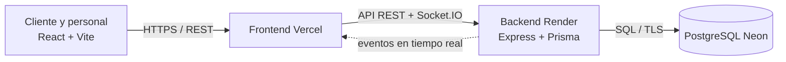

# Biander — Restobar Operations Platform

Biander centraliza la operación diaria de un restobar: menú QR y preórdenes por mesa, aprobación del garzón, preparación en cocina, cobro por mesa y cuadratura de caja. Los cambios de órdenes se distribuyen en tiempo real para que cada equipo trabaje con el mismo estado.

## Stack

- **Frontend:** React 19, TypeScript, Vite, React Router, Axios, Socket.IO Client.
- **Backend:** Node.js 20, Express 5, TypeScript, Prisma ORM, Socket.IO.
- **Datos:** PostgreSQL (Neon en el despliegue actual).
- **Calidad:** TypeScript, Vitest, Supertest y GitHub Actions.
- **Cloud actual/objetivo:** frontend en Vercel, API y Socket.IO en Render, PostgreSQL administrado en Neon.

## Arquitectura



El backend expone una API REST bajo `/api` y Socket.IO para eventos en tiempo real. El endpoint `/api/health` comprueba la conexión efectiva a PostgreSQL y devuelve `503` cuando la base de datos no responde.

## Roles

| Rol | Responsabilidades |
| --- | --- |
| `ADMIN` | Usuarios, productos, categorías y mesas; acceso operativo completo. |
| `CASHIER` | Mesas por cobrar, registro de pagos y cierre/cuadratura de caja. |
| `WAITER` | Preórdenes QR, edición/aprobación, pedidos manuales y entrega de platos. |
| `KITCHEN` | Cola de cocina, preparación y notificación de platos listos. |

## API principal

Las rutas protegidas requieren `Authorization: Bearer <token>`. Las rutas de gestión de usuarios requieren rol `ADMIN`; las rutas de caja requieren `CASHIER` o `ADMIN`.

| Método | Ruta | Uso / acceso |
| --- | --- | --- |
| `GET` | `/api/health` | Health check con conectividad PostgreSQL. |
| `POST` | `/api/auth/login` | Inicio de sesión y emisión JWT. |
| `GET` | `/api/auth/users` | Lista de usuarios (`ADMIN`). |
| `POST` | `/api/auth/register` | Crea usuarios (`ADMIN`). |
| `GET` | `/api/products`, `/api/categories` | Catálogo público. |
| `GET` | `/api/tables` | Consulta mesas (autenticado). |
| `POST` / `DELETE` | `/api/tables` y `/api/tables/:id` | Gestión de mesas (`ADMIN`). |
| `POST` | `/api/orders` | Crea preorden pública desde QR. |
| `GET` | `/api/orders` | Consulta de órdenes (autenticado; visibilidad según rol). |
| `POST` | `/api/orders/manual` | Pedido directo del garzón (`WAITER`, `ADMIN`). |
| `PATCH` | `/api/preorders/:id` | Edita preorden pendiente (`WAITER`, `ADMIN`). |
| `PATCH` | `/api/orders/:id/approve`, `/reject`, `/:id/status` | Aprobación, rechazo y estados operativos. |
| `GET` | `/api/cashier/tables`, `/sales`, `/summary` | Mesas por cobrar, ventas y resumen (`CASHIER`, `ADMIN`). |
| `POST` | `/api/cashier/tables/:tableId/pay`, `/close` | Cobro de mesa y cierre de caja. |

Socket.IO emite eventos de orden a salas por rol (`WAITER`, `KITCHEN`, `CASHIER`) para actualizar los paneles sin recarga.

## Ejecución local

Requisitos: Node.js 20+, npm y PostgreSQL local o una instancia de desarrollo.

1. Crea los archivos de entorno a partir de las plantillas:

   ```sh
   cp restobar-backend/.env.example restobar-backend/.env
   cp restobar-frontend/.env.example restobar-frontend/.env
   ```

2. Configura `DATABASE_URL`, `DIRECT_URL`, `JWT_SECRET` y `SEED_DEFAULT_PASSWORD` en el entorno del backend. Usa valores propios y no subas `.env` al repositorio. `SEED_DEFAULT_PASSWORD` establece la clave inicial del ADMIN maestro durante el seed; los usuarios de operación se crean luego desde `/admin/users`.

3. Instala dependencias, genera Prisma Client y prepara la base de desarrollo:

   ```sh
   cd restobar-backend
   npm ci
   npx prisma generate
   npx prisma migrate dev
   npx prisma db seed
   npm run dev
   ```

   En un entorno desplegado con migraciones ya revisadas, usa `npx prisma migrate deploy` en lugar de `migrate dev`.

4. En otra terminal, instala y ejecuta el frontend:

   ```sh
   cd restobar-frontend
   npm ci
   npm run dev
   ```

   La app queda disponible en Vite (`http://localhost:5173`) y la API en `http://localhost:4000`.

## Tests y builds

Las pruebas del backend usan Vitest y Supertest. Mockean la consulta del health check, por lo que no necesitan acceso a PostgreSQL ni a datos de producción.

```sh
cd restobar-backend
npm test
npm run build

cd ../restobar-frontend
npm run build
```

GitHub Actions ejecuta estas comprobaciones al hacer `push` o abrir un `pull_request` hacia `main`.

## Cloud Architecture & Scalability Roadmap (AWS / GCP)

### AWS

- **Frontend:** mantener Vercel o servir los artefactos estáticos desde S3 + CloudFront.
- **API y Socket.IO:** empaquetar el backend en Docker y desplegarlo en ECS Fargate detrás de un Application Load Balancer. Escalar tareas según CPU, memoria y conexiones concurrentes.
- **PostgreSQL:** migrar Neon a Amazon RDS for PostgreSQL Multi-AZ. Usar RDS Proxy para agrupar conexiones de las tareas efímeras y evitar agotar el límite de conexiones.
- **Secretos:** guardar `DATABASE_URL`, `JWT_SECRET` y credenciales de servicios en AWS Secrets Manager; inyectarlos durante el despliegue y rotarlos sin incluirlos en imágenes.
- **Socket.IO horizontal:** configurar `@socket.io/redis-adapter` con ElastiCache for Redis Pub/Sub para compartir eventos entre tareas. Configurar afinidad de sesión en el balanceador si se mantiene long-polling, además de health checks y drenaje de conexiones durante despliegues.

### GCP

- **Frontend:** Vercel o Cloud Storage con Cloud CDN.
- **API y Socket.IO:** contenedor en Cloud Run con mínimo de instancias, concurrencia y escalado configurados según la carga. Validar límites de conexión y duración de sesiones WebSocket antes de fijar el dimensionamiento.
- **PostgreSQL:** Cloud SQL for PostgreSQL con alta disponibilidad y backups automáticos; usar el conector/proxy de Cloud SQL y límites explícitos del pool Prisma.
- **Secretos:** guardar claves y cadenas de conexión en Secret Manager y conceder acceso mediante una identidad de servicio con privilegios mínimos.
- **Socket.IO horizontal:** usar Memorystore for Redis con `@socket.io/redis-adapter` para publicar eventos entre instancias. Añadir métricas de conexiones, latencia y memoria para ajustar instancias y capacidad Redis.

### Evolución común

Separar la configuración por ambiente, ejecutar migraciones como una tarea controlada de release, añadir métricas y trazas, definir políticas de backup/restore y probar recuperación. Para cargas mayores, desacoplar trabajos lentos mediante una cola y mantener PostgreSQL como fuente de verdad; Redis se reserva para coordinación/pub-sub y caché efímera.

## Cuentas Demo

Puedes probar los distintos flujos y vistas de **Biander** utilizando estas credenciales:

| Rol | Correo | Contraseña |
| :--- | :--- | :--- |
| **Garzón (`WAITER`)** | `garzon@demo.com` | `garzon01` |
| **Cocina (`KITCHEN`)** | `cocina@demo.com` | `cocina01` |
| **Caja (`CASHIER`)** | `cajero@demo.com` | `cajero01` |
